# ClearPass Policy Visualiser

Visualise, analyse and troubleshoot Aruba ClearPass Services, Role Mapping Policies, Enforcement Policies and Enforcement Profiles.

<p align="center">
  <a href="https://www.python.org/"></a>
  <a href="https://flask.palletsprojects.com/"></a>
  <a href="https://www.hpe.com/us/en/products/networking/clearpass-policy-manager.html"></a>
  <a href="LICENSE"></a>

---

## Overview

ClearPass Policy Visualiser (CPV) is a Flask application that shows the complete ClearPass authentication and authorisation flow (Services, authentication and authorisation sources, Role Mapping Policies, Roles, Enforcement Policies, Enforcement Profiles and Endpoint Repository conditions) as interactive graphs and read-only reports.

It helps administrators understand, review and clean up ClearPass configuration without navigating multiple areas of Policy Manager, and to check what a change will affect before making it.

**New in v1.7.0:** one CPV instance can manage up to three ClearPass environments, such as Production, Test and Dev, each with its own connection settings and sign-in.

<p align="center">
  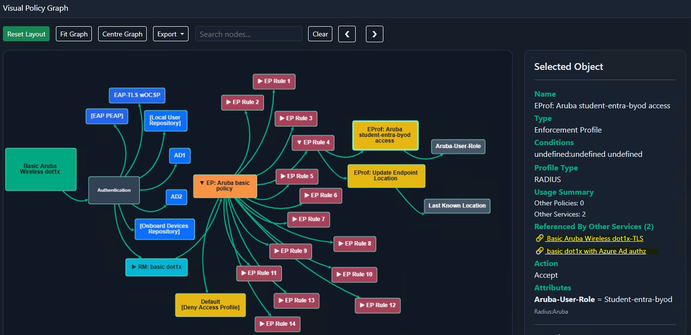
</p>

For step-by-step installation, ClearPass API access and usage, see the [ClearPass Policy Visualiser technote](https://solutiontechlab.com/2026/08/22/clearpass-policy-visualiser/).

---

## Screenshots

### Setup Validation

Before configuration is saved, the Visualiser validates connectivity to the configured services.

<p align="center">
  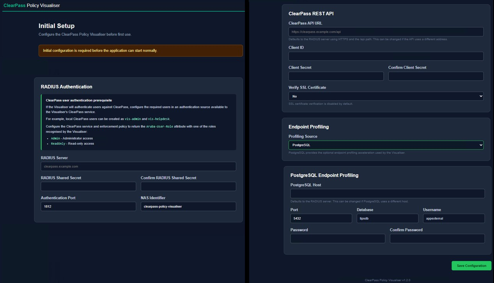
</p>

<p align="center">
  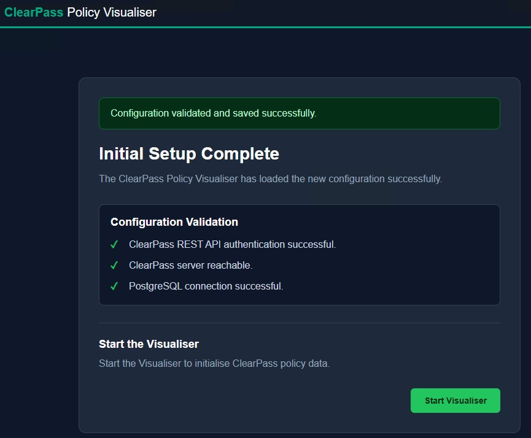
</p>

### API-Assisted ClearPass Configuration

Initial Setup can inspect, create and verify the ClearPass objects required for Policy Visualiser.

<p align="center">
  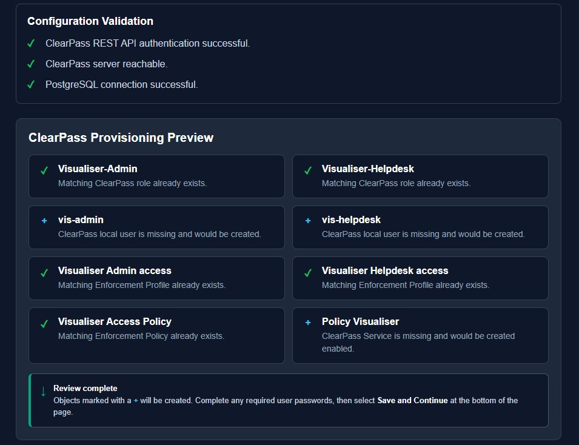
</p>

### Setup Complete Provisioning Summary

Setup Complete reports which ClearPass objects were created and which existing objects were validated and left unchanged.

<p align="center">
  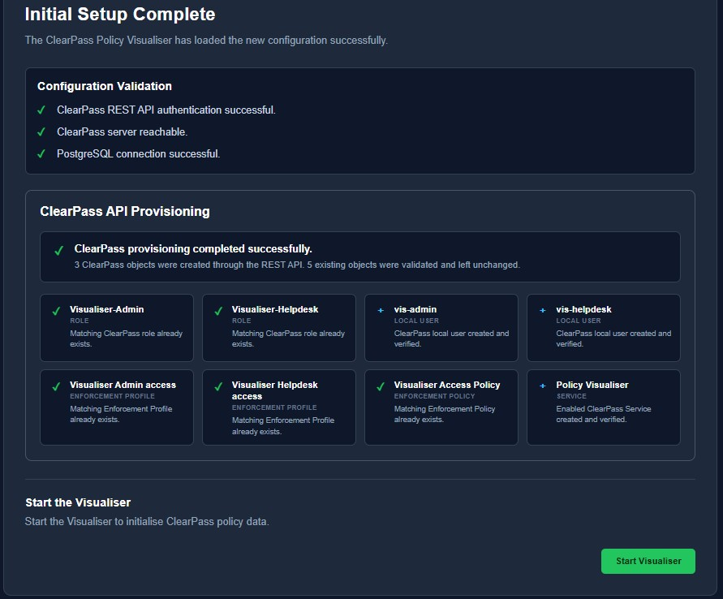
</p>

### App Startup

<p align="center">
  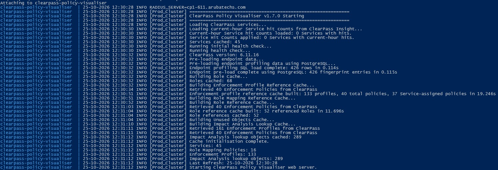
</p>

### Login Page

<p align="center">
  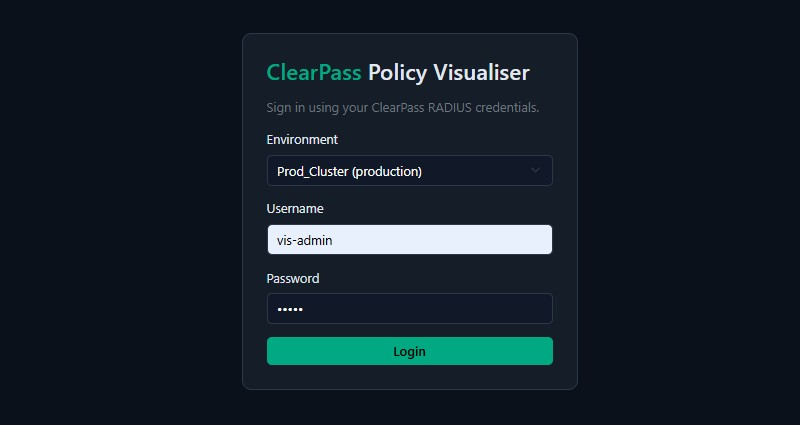
</p>

### Dashboard

<p align="center">
  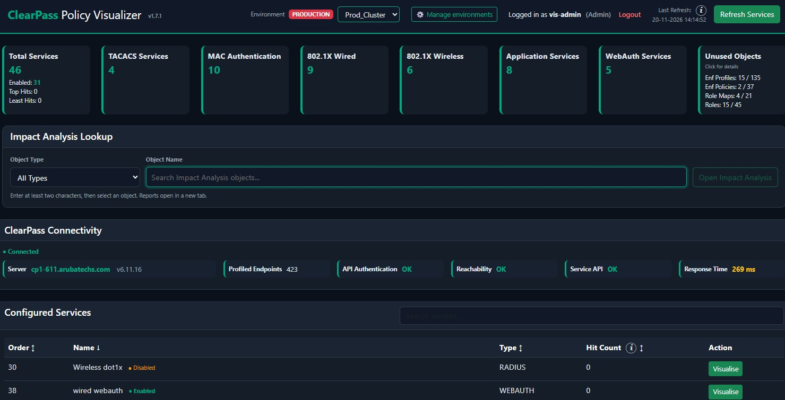
</p>

### Impact Analysis

<p align="center">
  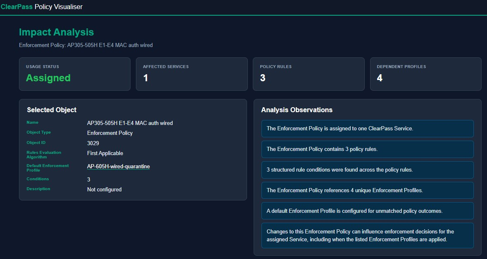
</p>
<p align="center">
  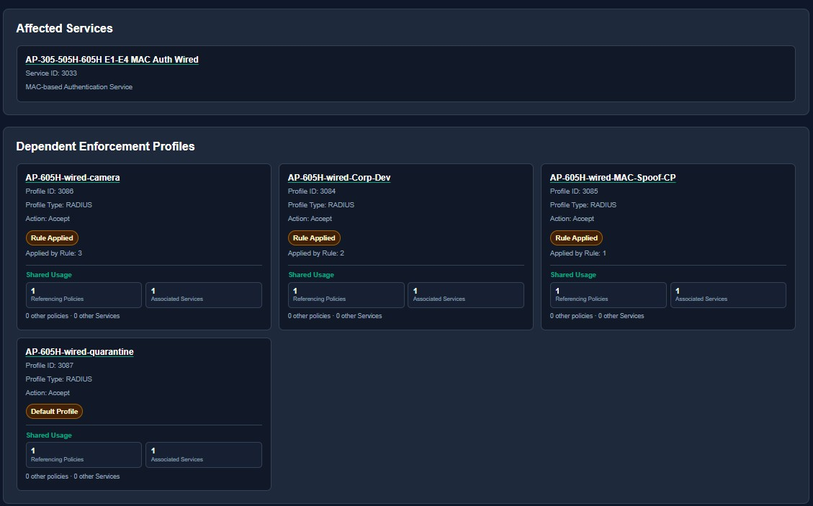
</p>
<p align="center">
  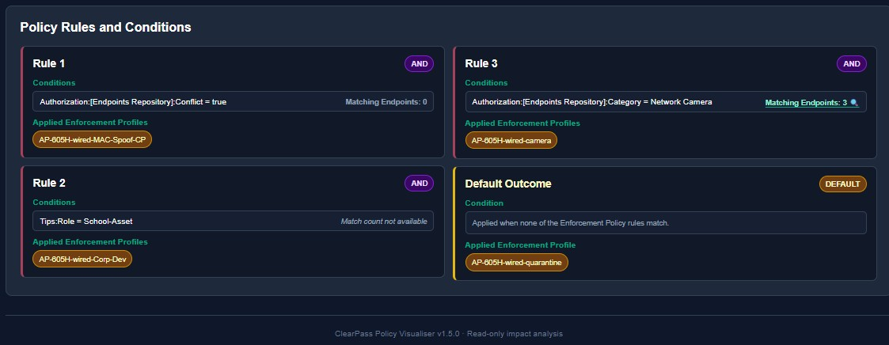
</p>


### Service Dependency Graph

<p align="center">
  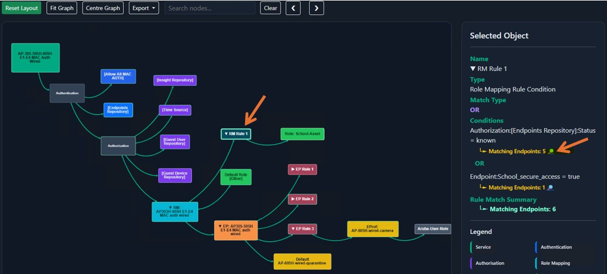
</p>

<p align="center">
  
</p>

### Repository Search

<p align="center">
  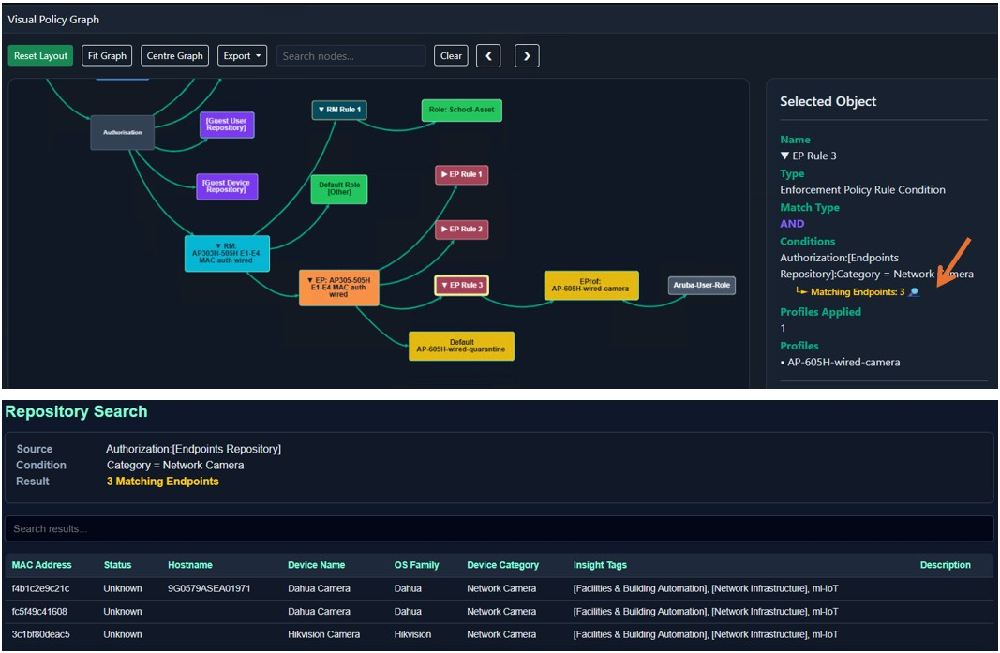
</p>

### Endpoint Details

<p align="center">
  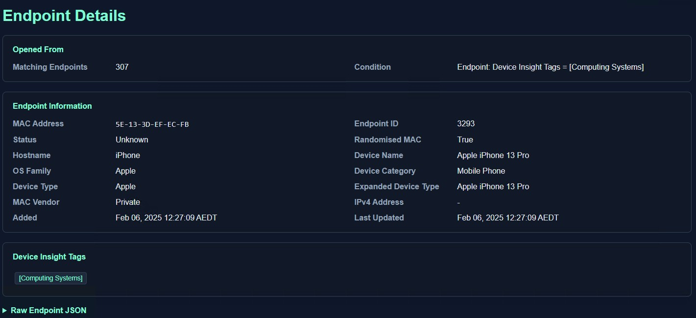
</p>

### Unused Objects

<p align="center">
  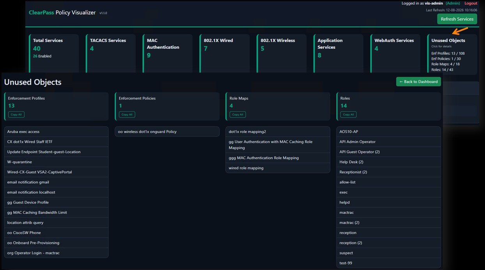
</p>

### Environments Page

<p align="center">
  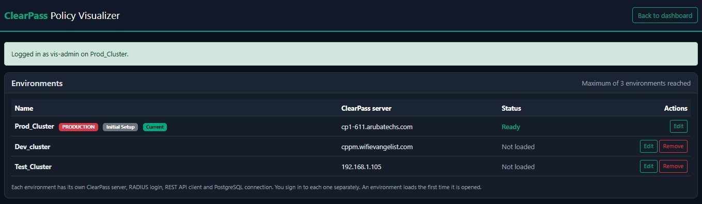
</p>

<p align="center">
  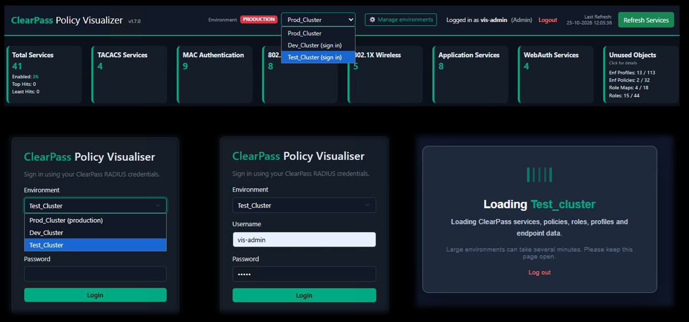
</p>

---

## Features

### Multiple ClearPass Environments

- Up to three environments, named freely, for example `Prod_Cluster`, `Test` or `Dev`.
- Each environment has its own REST API client, RADIUS server and PostgreSQL connection, and its own cached data.
- Users sign in to each environment separately through that environment's RADIUS server, so a user can be Admin in one and ReadOnly in another.
- Switch environments from the navbar. Environments other than the initial one load in the background the first time they are opened, with a loading panel and a **Try again** option if loading fails.
- The active environment is shown on every page and report, in the application log as a `[Name]` tag, in exported PDF headers and in exported file names. An optional red **PRODUCTION** badge marks live environments.

### Environments Page (Administrators)

Open **Manage environments** from the dashboard to:

- **Add** an environment. The form follows the Initial Setup flow, with guidance, connection testing before saving and optional assisted provisioning of the required ClearPass objects.
- **Edit** an environment, including the initial one created by Initial Setup. Changing connection settings retests them, saves them and reloads the environment. For the initial environment, the previous settings are kept as `.visualiser.env.prev`, and a RADIUS change that fails its test must be confirmed before it is saved.
- **Rename** an environment or set its production flag without reloading it.
- **Remove** an environment other than the initial one.

Status updates on the page while an environment is loading.

### Initial Setup

On first start, CPV opens a browser-based Initial Setup that configures and validates:

- ClearPass REST API (OAuth 2.0 client credentials) and SSL verification
- RADIUS server, shared secret and NAS Identifier
- PostgreSQL access using the built-in `appexternal` account

Configuration is saved only when validation passes.

**Assisted provisioning (optional)** creates or validates the objects CPV needs in ClearPass: the `Visualiser-Admin` and `Visualiser-Helpdesk` roles, two Local Users, Admin and ReadOnly Enforcement Profiles, the `Visualiser Access Policy` and the enabled `Policy Visualiser` RADIUS Service (802.1X Wired template, PAP, Local User Repository, matched on the Visualiser usernames and NAS Identifier).

A read-only **Review ClearPass Changes** step reports each object as `existing`, `would_create` or `conflict` before anything is changed. Provisioning is idempotent: matching objects and existing passwords are left unchanged, conflicts are never overwritten, nothing is deleted, and created objects are verified. Local User passwords are never saved.

### Connection Diagnostics

When a connection check fails, CPV explains why in plain language, for example:

- the name does not resolve, nothing answers, or there is no route
- the host is up but the port is blocked or refused
- the URL path is wrong (`/api` expected), `http://` or port 80 was used, or the certificate is not trusted
- PostgreSQL rejected the password, or the source address is not allowed

Amber notes flag a PostgreSQL or RADIUS host that differs from the API host, and hosts copied from another environment by mistake.

**RADIUS check.** CPV sends one PAP test request for the user `cpv-connectivity-test` with a random password. A signed reply proves the server is reachable, accepts this host and shares the secret. The request appears in ClearPass Access Tracker as a rejected authentication, usually with "Service Categorization failed". This is expected.

### Dashboard and Service Hit Counts

- ClearPass health, response time and version for the active environment.
- Service inventory sortable by Order, Name, Type and Hit Count.
- Current-hour Service Hit Counts from ClearPass Insight, with Top and Least Hits. Counts reset at the start of each clock hour and are recalculated on **Refresh Services**. If Insight cannot be reached, counts show `n/a` and the rest of CPV loads normally.
- **Impact Analysis Lookup** across Enforcement Profiles, Enforcement Policies, Role Mapping Policies and Roles, including unused and built-in objects, with type filters and keyboard navigation.

### Visualisation

Interactive graphs of Services and standalone policies, with zoom, pan, expandable branches, node search, Impact Analysis links on policy, profile and Role nodes, and PNG, JPG and SVG export.

### Impact Analysis

Read-only reports, opened in a new tab so the graph state is kept, for:

- **Enforcement Profiles:** referencing policies and affected Services, including policies not assigned to any Service.
- **Enforcement Policies:** rules and conditions, dependent profiles, default outcome and affected Services.
- **Role Mapping Policies:** rules and conditions, mapped Roles, default outcome and affected Services.
- **Roles:** references in Role Mapping Policies, `Tips:Role` conditions, Enforcement Policies and Guest Operator Profiles.

Endpoint Repository conditions show match counts with links to **Repository Search** and endpoint details. Reports can be downloaded as print-ready PDF or complete JSON.

### Unused Objects

Dependency-based detection of unused Enforcement Profiles, Enforcement Policies, Role Mapping Policies and Roles, with **Copy All**. Built-in objects in square brackets are excluded. An Enforcement Profile counts as unused only when no Enforcement Policy references it.

### Endpoint Profiling

Endpoint profiling (hostname, device category, family, name and type, MAC vendor, IPv4 address) is loaded from ClearPass PostgreSQL at startup. In the reference environment this took about 0.08 seconds, compared with about 74 seconds through the REST API.

---

## Architecture and Data Sources

| Data | Source | Authentication |
|------|--------|----------------|
| CPV user sign-in | ClearPass RADIUS, per environment | PAP |
| Services, policies, profiles, Roles, Local Users, Operator Profiles, Endpoint Repository | ClearPass REST API | OAuth 2.0 client credentials |
| Endpoint profiling | PostgreSQL `tipsdb` (port 5432), `tips_endpoint_profiles` | `appexternal` |
| Current-hour Service Hit Counts | PostgreSQL `insightdb` (port 5433), `public.auth` | `appexternal` |

CPV application roles come from the RADIUS reply attribute `Aruba-User-Role`:

| `Aruba-User-Role` | CPV access |
|-------------------|------------|
| `Admin` | Administrator, including the Environments page |
| `ReadOnly` | Read-only |

---

## Requirements

- Aruba ClearPass Policy Manager. Tested with 6.11.x and 6.14.1.
- A ClearPass API Client (client credentials) with read access to the objects above, plus create access if assisted provisioning is used. Find it under **Administration › API Services › API Clients**.
- The CPV host defined as a RADIUS Network Device in each ClearPass. ClearPass sees the Docker host's address, not the container's.
- Network access from CPV to ClearPass on HTTPS (443), RADIUS (UDP 1812), PostgreSQL (5432) and Insight (5433).
- The `appexternal` password, set under **Administration › Server Manager › Server Configuration › Cluster-Wide Parameters › Database** (External PostgreSQL Password).
- Docker Engine with Docker Compose v2 (recommended), or Python 3.11 or later.

---

## Installation

### Docker (recommended)

```bash
git clone https://github.com/ariyaparsa-dev/clearpass-policy-visualiser.git
cd clearpass-policy-visualiser
docker compose up --build
```

Open `http://127.0.0.1:5000`. A new installation starts in Initial Setup.

| Task | Command |
|------|---------|
| Run in the background | `docker compose up -d` |
| Follow the logs | `docker compose logs -f` |
| Stop | `docker compose down` |

Configuration is kept in the `clearpass-visualiser-data` volume and survives container rebuilds. The container runs as a non-root user and publishes only `127.0.0.1:5000`.

The container uses UTC by default. To change it, create a `.env` file next to `compose.yaml` containing, for example, `TZ=Australia/Melbourne`. This file is only for Docker settings and is separate from `.visualiser.env`.

### Native Python

```bash
git clone <repository-url>
cd clearpass-policy-visualiser
python -m venv venv
venv\Scripts\activate          # Windows
source venv/bin/activate       # Linux and macOS
python -m pip install -r requirements.txt
python app.py
```

---

## Configuration Files

| File | Contents |
|------|----------|
| `.visualiser.env` | Initial environment settings and secrets, written by Initial Setup or the Environments page |
| `.visualiser.env.prev` | Previous initial environment settings, kept after an edit on the Environments page |
| `environments/<id>.env` | Settings and secrets for each additional environment |
| `.flask_secret` | Session signing key, generated on first start unless `FLASK_SECRET_KEY` is set |

With Docker these are in `/data` in the `clearpass-visualiser-data` volume. Natively they are in the application directory. All are written with owner-only permissions, are excluded from Git, and should be protected and backed up as secrets.

Values are stored quoted, so secrets containing spaces, `#` or quotes are kept exactly. A value containing a variable reference such as `${NAME}` is refused.

To change connection settings, use **Manage environments**. You do not need to edit the files or restart CPV.

---

## Refreshing Data

**Refresh Services** rebuilds the active environment's data from ClearPass: health, Services, Hit Counts, Roles, reference caches, Unused Objects and the Impact Analysis lookup. Other environments are not affected.

---

## Security Considerations

- Restrict access to the CPV host and to the `clearpass-visualiser-data` volume.
- Use a ClearPass API Client scoped to what CPV needs.
- Enable SSL certificate verification when ClearPass has a trusted certificate.
- Use the read-only review before assisted provisioning, and resolve any reported conflicts manually.
- Delete `.visualiser.env.prev` and any manual backups when no longer needed, because they contain secrets.
- Rotate credentials according to local policy, then update them through **Manage environments**.

---

## Project Structure

```text
clearpass-policy-visualiser
├── app.py, server.py, version.py, cp_paths.py
├── Dockerfile, compose.yaml, requirements.txt
├── cp_env.py, cp_env_web.py         # per-environment state, sign-in and loading
├── cp_environments.py               # environment registry and files
├── cp_default_env.py                # editing the initial environment
├── env_admin.py                     # Environments page
├── cp_setup.py, cp_provision.py     # Initial Setup, validation and provisioning
├── cp_netdiag.py                    # connection and RADIUS diagnostics
├── cp_client.py, cp_cache.py, cp_health.py, cp_services.py
├── cp_insight_sql.py, cp_endpoint.py, cp_endpoint_sql.py
├── cp_enforcement.py, cp_role_mapping.py, cp_role_references.py
├── cp_graph.py, cp_object_graph.py, cp_unused_objects.py
├── cp_impact_analysis.py, cp_impact_lookup.py
├── auth/
├── sql/endpoint_profiles.sql
├── templates/
├── static/service_graph.js
├── screenshots/
└── LICENSE, NOTICE, README.md
```

---

## Roadmap

- Granular role-based access controls for administrative and analysis functions
- Native ClearPass Extension integration

---

## Changelog

### v1.7.1

#### Security
- Initial Setup can no longer be submitted once setup is complete.
- Refresh Services now requires a POST with a CSRF token.
- Removed a debug route that returned raw ClearPass Service data.

#### Reliability when ClearPass is unreachable
- CPV starts even when the initial environment's ClearPass cannot be reached. Other environments stay available, and Try again loads it once it is back.
- Refresh Services checks ClearPass first, and keeps the loaded data if ClearPass is unreachable.
- A connection lost during a refresh stops it cleanly instead of building partial data.
- Pages that need live ClearPass data show a "ClearPass is unreachable" page instead of an error.
- RADIUS name-resolution failures and unreachable environments are logged as one clear line.

#### Performance
- The ClearPass API login is reused per environment. 
- Lighter health check
- Refresh Services now rereads Enforcement Policies, so policy changes in ClearPass appear after a refresh

#### Dashboard
- Profiled Endpoints (in CPV) counts only endpoints that ClearPass has profiled. The ClearPass Endpoint Repository also includes endpoints that haven't been profiled yet, so its total may be higher. The count updates when the environment loads, not on Refresh Services
- An info button next to Last Refresh shows the time each load step took.
- Larger, consistent info icons.


### v1.7.0

#### Multiple ClearPass environments
- Up to three environments with free-text names and an optional production flag.
- Separate REST API, RADIUS and PostgreSQL settings, cached data and sign-in for each environment.
- Navbar environment selector, with the active environment shown on every page and report.
- Background loading of additional environments, with an animated loading panel and **Try again**.
- Environment name tags in the application log, PDF report headers and exported file names.
- ClearPass version shown on the dashboard connectivity card.

#### Environments page
- Add, edit, rename and remove environments, available to administrators from **Manage environments**.
- Add form follows Initial Setup, with guidance, automatic host defaults and optional assisted provisioning.
- Initial environment connection settings can be edited and applied without a restart. Previous settings are kept as `.visualiser.env.prev`, and an unconfirmed RADIUS change needs explicit confirmation.
- Environment status updates automatically while an environment is loading.

#### Connection diagnostics
- Plain-language explanations for DNS, refused, blocked, unreachable and no-route failures, using DNS, ping and port probes.
- Specific messages for wrong REST API paths, `http://` and port 80, redirects, certificate errors and PostgreSQL password or address rejections.
- The connectivity check now tests the port the REST API really uses.
- Repeated failures on the same host are reported once.
- RADIUS reachability and shared-secret check using a `cpv-connectivity-test` request.
- Amber warnings for PostgreSQL or RADIUS hosts that differ from the API host or were copied from another environment.

#### Other changes
- Hit Counts show `n/a` when Insight is unavailable, and the environment still loads.
- Initial Setup stores values quoted and verifies the file before replacing the old one.
- Duplicate messages are no longer shown twice on setup pages.
- The navbar has been redesigned, including a **Manage environments** button.
- Shared Role analysis and the standalone packaged release were removed from the roadmap.

### v1.6.1
- Current-hour Service Hit Counts from ClearPass Insight, with Top and Least Hits on the dashboard and on Service pages.
- Service table sortable by Order, Name, Type and Hit Count.

### v1.6.0
- Licence changed from MIT to Apache 2.0, and a `NOTICE` file was added.
- Docker deployment with Compose, Waitress, a non-root user, a persistent volume and `TZ` support.
- Endpoint profiling moved to PostgreSQL, with no REST API fallback.

### v1.5.x
- **1.5.3:** more robust handling of unexpected Endpoint and Guest API responses, and of cache initialisation.
- **1.5.2:** Role Impact Analysis.
- **1.5.1:** PDF and JSON export for all Impact Analysis reports.
- **1.5.0:** Enforcement Policy and Role Mapping Policy Impact Analysis, and the dashboard Impact Analysis Lookup.

### v1.4.0
- Enforcement Profile Impact Analysis, including policies not assigned to a Service.

### v1.3.x
- **1.3.1:** SVG graph export.
- **1.3.0:** API-assisted ClearPass configuration with a read-only change review and idempotent provisioning.

### v1.2.0 and earlier
- **1.2.0:** browser-based Initial Setup, replacing `config.yaml`.
- **1.1.x:** Unused Object analysis and Enforcement Profile details.
- **1.0.0:** first public release.

---

## License

Licensed under the Apache License, Version 2.0. See `LICENSE` and `NOTICE`.

## Disclaimer

This is an independent community tool. It is not affiliated with, endorsed by or supported by Hewlett Packard Enterprise (HPE). Validate changes before applying them to production, and treat Unused Object results as candidates for review.

## Acknowledgements

Aruba ClearPass, HPE Aruba Networking, Flask, Cytoscape.js and pyclearpass.

---

**ClearPass Policy Visualiser v1.7.0**

Visualise. Analyse. Troubleshoot.
